# Simplifica+

**Global Solution 2026.2 – CitizenTech**
Aplicativo mobile em **Flutter/Dart** para pagamento de contas com foco em **Design Universal e acessibilidade digital**.

---

## 👥 Desenvolvedores

| RM | Nome completo |
|----|---------------|
| 558864 | Isaque Santana Paixão |
| 555733 | Karla Louise Famula de Melo |

---

## 🔗 Links

- **Repositório no GitHub:** https://github.com/KarlaFamula/GS2-Flutter-SimplificaMais


---

## 💡 Descrição da Solução

O **Simplifica+** facilita a leitura e o pagamento das contas do dia a dia (água, luz e boletos) para pessoas que sofrem com a **exclusão digital**: idosos, pessoas com deficiência visual ou motora, pessoas neurodivergentes e pessoas com pouca familiaridade com tecnologia.

Muitos apps de banco e de serviços têm menus escondidos, letras pequenas e muitos passos. Por isso, muita gente depende de outra pessoa para fazer uma tarefa simples como pagar um boleto. O Simplifica+ resolve isso com:

- **Letras e botões grandes**, fáceis de ler e de tocar;
- **Ilustrações** que explicam cada tela sem depender só do texto;
- **Barra de abas fixa** (Início, Ajuda e Perfil), sempre visível, com ícone e texto;
- **Fluxo curto e direto**: um botão gigante "PAGAR CONTA" na tela inicial;
- **Linguagem simples** e uma aba de **Ajuda** com perguntas frequentes;
- **Status com ícone + texto** (não depende só da cor, pensando em pessoas daltônicas);
- **Confirmação antes de pagar**, para evitar toques acidentais;
- **Valores e taxas mostrados separadamente**, para a pessoa saber exatamente quanto vai pagar;
- **Endereço preenchido automaticamente pelo CEP**, sem precisar digitar tudo;
- **Descrições para leitor de tela** (`Semantics`, `semanticLabel` e `tooltip`).

O objetivo é dar **autonomia financeira** para essas pessoas, reduzindo a barreira tecnológica.

---

## 🌎 Tema da Global Solution

**CitizenTech**: tecnologias criadas a partir das necessidades reais das pessoas.

O Simplifica+ se encaixa na sugestão do desafio **"Tecnologias de apoio a idosos e pessoas com deficiência para ampliar autonomia, segurança e acesso a serviços"** e está conectado ao **ODS 10 – Redução das Desigualdades**, porque diminui a desigualdade de acesso aos serviços digitais.

---

## 🔀 Fluxo de Telas

```
Splash ──► Onboarding (3 páginas) ──► Meu Endereço (ViaCEP) ──► Tela Principal (barra de abas)
                                                                  │
                                    ┌─────────────────────────────┼─────────────────┐
                                    ▼                             ▼                 ▼
                                 Início                         Ajuda             Perfil
                                    │                                               │
                         ┌──────────┴──────────┐                     ┌──────────────┴─────────────┐
                         ▼                     ▼                     ▼                            ▼
                      Scanner ──────► Detalhes da Conta        Meu Endereço                 Onboarding
                                                               (alterar endereço)          (rever introdução)
```

1. **Splash** – Mostra o logo e consulta o SharedPreferences para decidir a próxima tela: Onboarding (se a introdução deve ser mostrada), Meu Endereço (se ainda não há endereço salvo) ou a Tela Principal.
2. **Onboarding** – 3 páginas com ilustração, título e descrição; botões **Voltar**, **Avançar** e **Pular**; opção **"Não mostrar novamente"**, salva no SharedPreferences e respeitada nas próximas aberturas.
3. **Meu Endereço** – O usuário digita o CEP e o app busca o endereço na API **ViaCEP**, tratando os estados *inicial*, *carregando*, *sucesso* e *erro* (com o botão **"Tentar novamente"**). O endereço fica salvo no aparelho.
4. **Tela Principal** – Barra de abas fixa embaixo com **Início**, **Ajuda** e **Perfil**. O botão voltar do celular leva de volta ao Início e, no Início, pergunta se a pessoa quer sair do app.
5. **Início** – Saudação com a cidade do usuário, botão gigante **"PAGAR CONTA"**, resumo com a quantidade e o total de contas pendentes, **filtro** (Todas / Pendentes / Pagas) e a **lista de contas**. Tocar numa conta abre os detalhes.
6. **Scanner** – Simula a leitura do código de barras (com animação) e abre a próxima conta pendente.
7. **Detalhes da Conta** – Recebe a conta **por parâmetro**, mostra o valor, a taxa e o total (calculados pelo **Strategy Pattern**) e permite **confirmar o pagamento**. Depois do pagamento aparece a mensagem "Pagamento realizado!" e a lista do Início é atualizada.
8. **Ajuda** – Perguntas frequentes em linguagem simples.
9. **Perfil** – Mostra o endereço salvo e permite alterá-lo ou rever a introdução.

> **Observação:** nesta versão (protótipo), a leitura do código de barras é **simulada** e o pagamento não é processado de verdade. A leitura real pela câmera e a integração com meios de pagamento são evoluções futuras.

---

## 📱 Prints das Telas

### 1. Splash
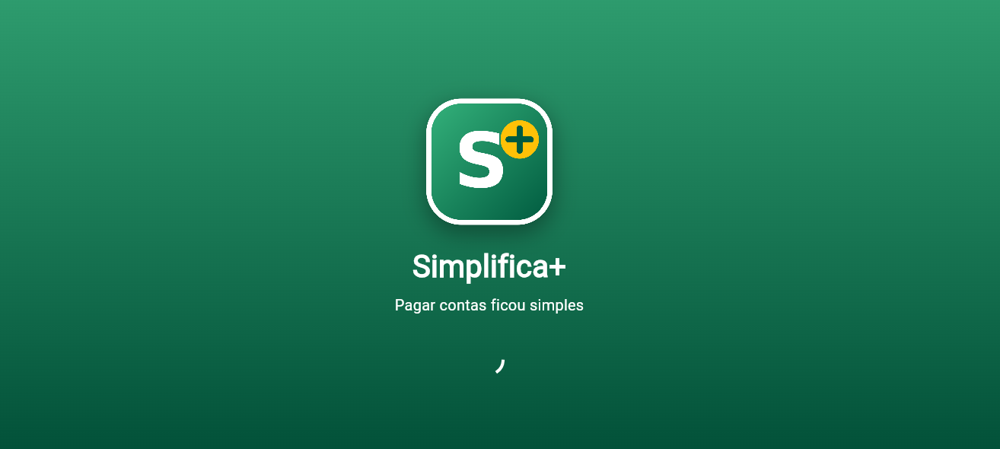

### 2. Onboarding (3 páginas, com "Não mostrar novamente", Voltar e Avançar)
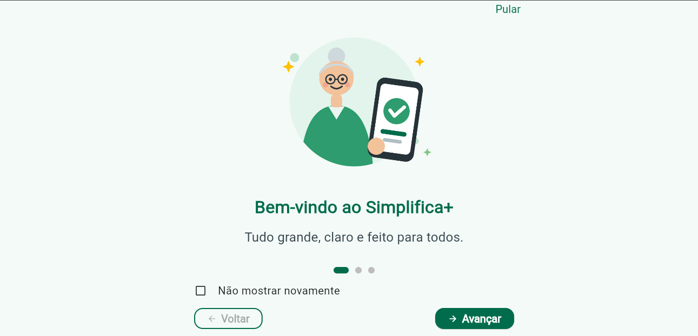
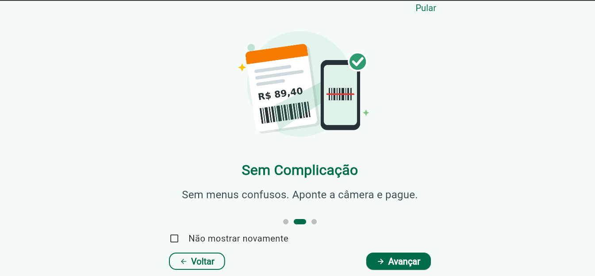


### 3. Meu Endereço – consumo da API ViaCEP
**Estado inicial**

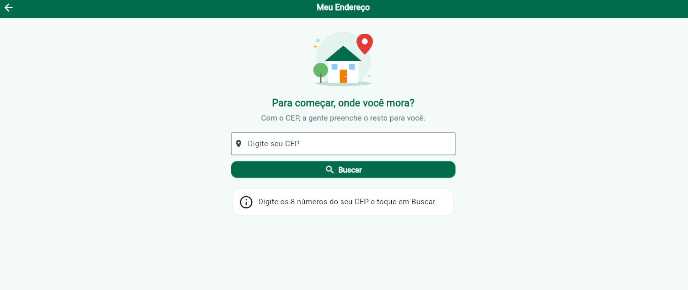

**Estado de erro, com "Tentar novamente"**

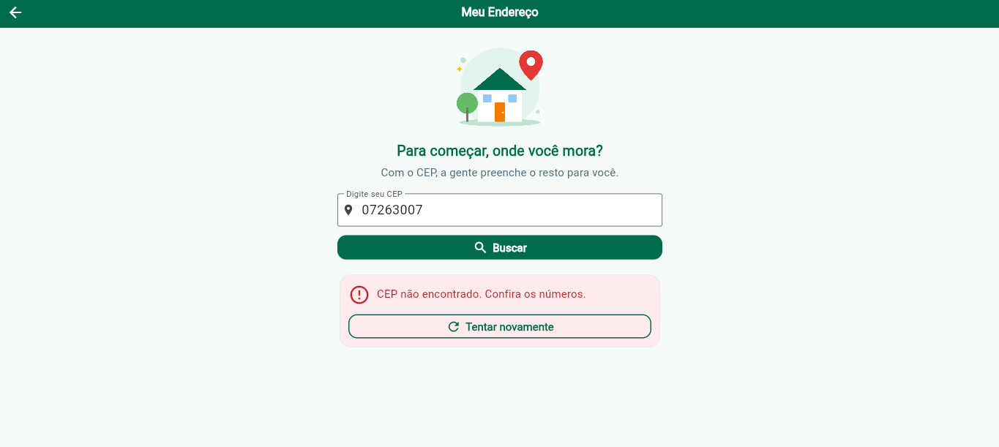

**Estado de sucesso, com o endereço retornado pela API**

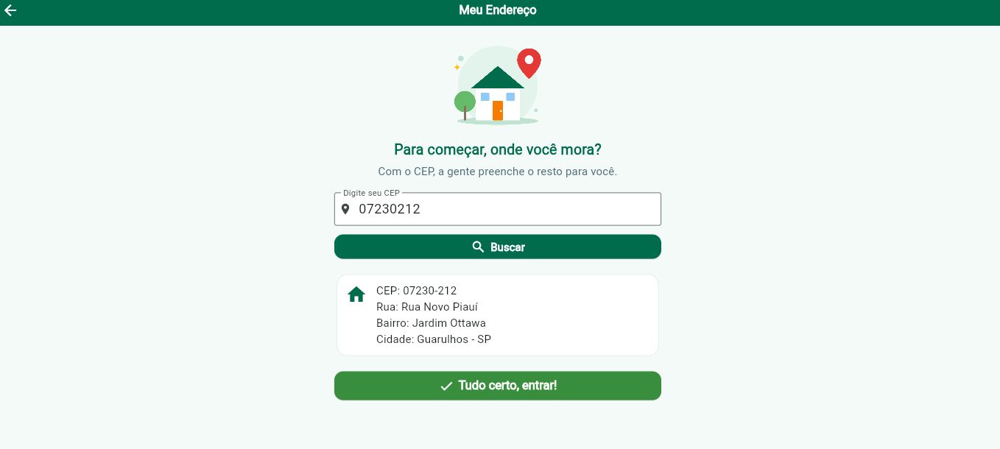

### 4. Início (com a barra de abas)
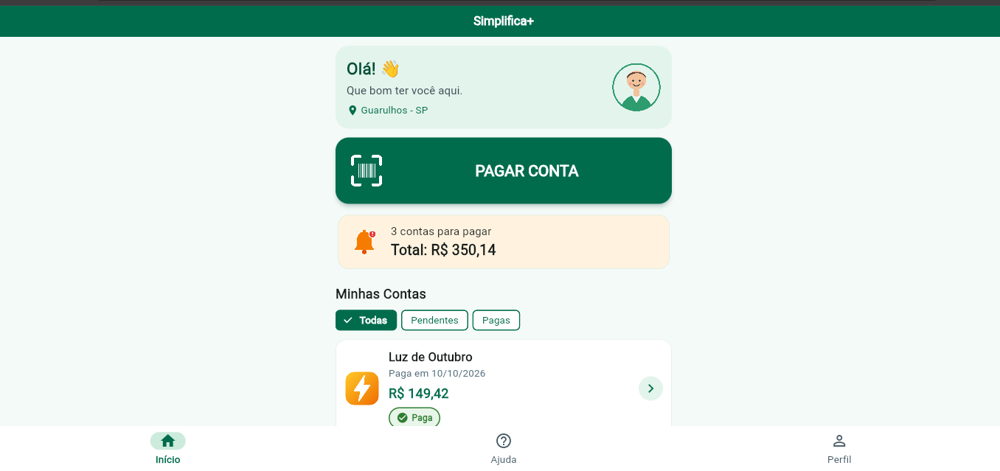

### 5. Scanner
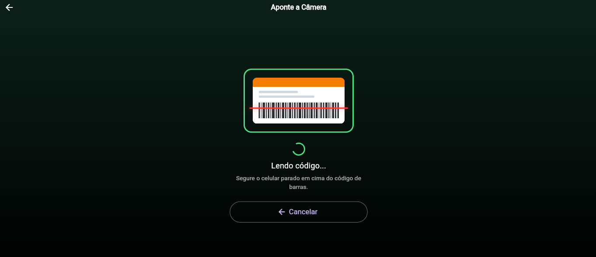

### 6. Detalhes da Conta e pagamento
**Conta de luz (taxa de 5% calculada pela Strategy)**

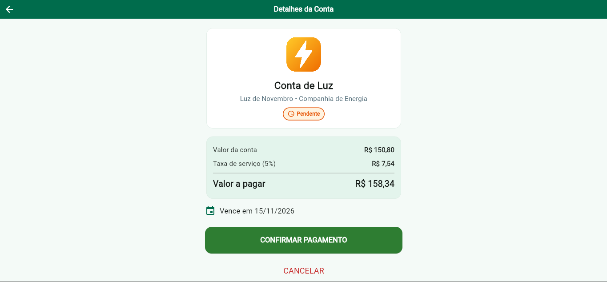

**Confirmação de pagamento**

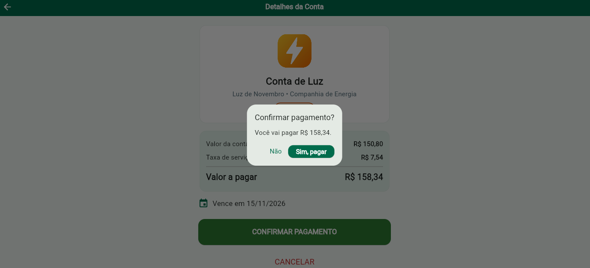

**Conta de água (sem taxa)**

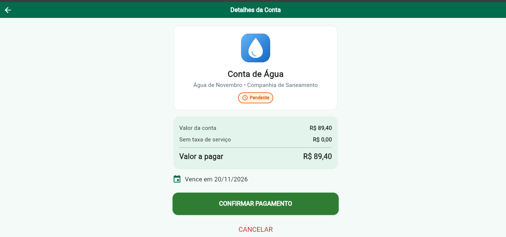

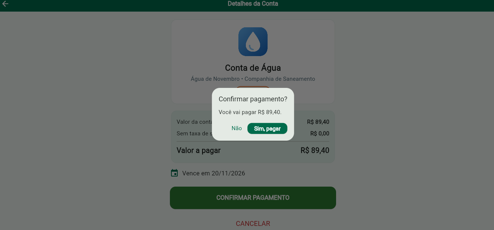

**Pagamento realizado**

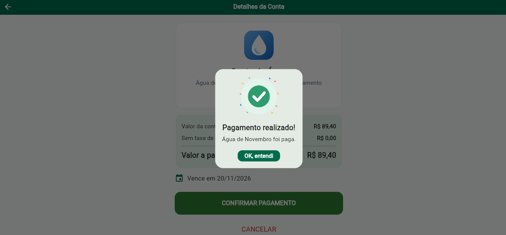

### 7. Lista atualizada depois dos pagamentos
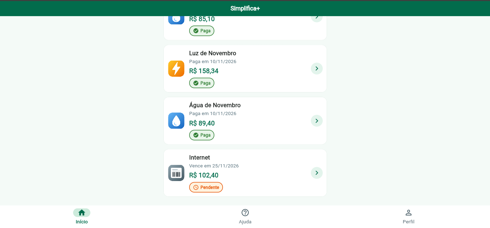

### 8. Ajuda (aba)
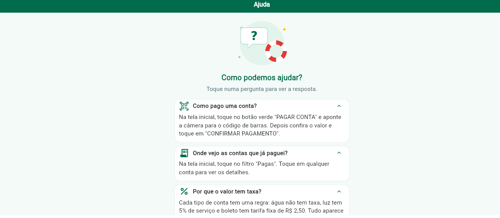

### 9. Perfil (aba)
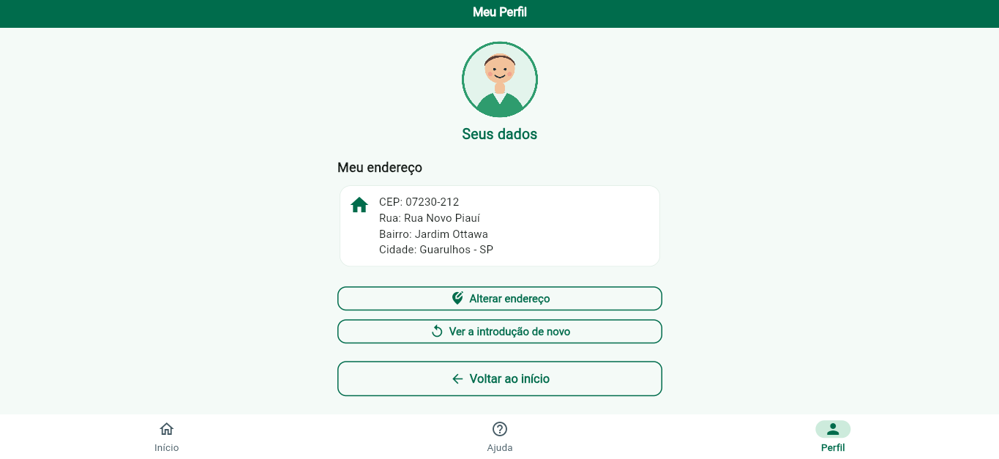

---

## 🌐 API Utilizada

**ViaCEP** – API REST pública e gratuita para consulta de endereços pelo CEP.

- **Endpoint:** `GET https://viacep.com.br/ws/{cep}/json/`
- **Pacote:** `http`
- **Uso no app:** preencher automaticamente o endereço do usuário (rua, bairro, cidade e UF) na tela **Meu Endereço**. A cidade também aparece na saudação do Início e o endereço completo no Perfil.
- O JSON recebido é convertido no model `Endereco` com o `factory Endereco.fromJson`.
- **Tratamento de erros:** CEP com menos de 8 números, CEP inexistente (`"erro": true`), código HTTP diferente de 200 e falta de conexão, sempre com uma mensagem amigável e o botão **"Tentar novamente"**.

Exemplo de resposta:
```json
{
  "cep": "01311-000",
  "logradouro": "Avenida Paulista",
  "bairro": "Bela Vista",
  "localidade": "São Paulo",
  "uf": "SP"
}
```

---

## 🏗️ Arquitetura

O projeto separa **interface**, **modelos**, **regras de negócio** e **acesso aos dados**:

```
assets/images/             # Logo, ilustrações e imagens dos tipos de conta (Image.asset)
lib/
├── main.dart              # MaterialApp, tema visual e rotas nomeadas
├── components/            # Widgets reutilizáveis
│   ├── area_conteudo.dart        # Limita a largura do conteúdo em telas grandes
│   ├── botao_gigante.dart
│   ├── botao_voltar.dart
│   ├── cabecalho_ilustrado.dart  # Ilustração + título no topo das telas
│   ├── card_conta.dart
│   ├── card_endereco.dart
│   ├── conteudo_onboarding.dart
│   ├── filtro_contas.dart
│   ├── linha_valor.dart
│   ├── mensagem_erro.dart
│   └── selo_status.dart
├── data/
│   └── conta_repository.dart     # Lista, filtra, paga e soma as contas
├── models/                # Conta, Endereco, FiltroConta, EstadoRequisicao, PaginaOnboarding, ItemAjuda
├── screens/               # Splash, Onboarding, Login (Meu Endereço), Principal (abas), Home, Scanner, Detalhes, Perfil, Ajuda
├── services/
│   ├── viacep_service.dart        # Comunicação com a API (pacote http)
│   └── preferencias_service.dart  # Persistência local (SharedPreferences)
├── strategy/
│   └── conta_strategy.dart        # Strategy Pattern dos tipos de conta
└── utils/
    └── formatadores.dart          # Formatação de moeda (R$) e data
```

### Camadas
- **screens** – Só cuidam da interface e do estado da tela (`setState`). Não têm regra de negócio.
- **components** – Widgets personalizados reutilizados em várias telas (ex.: `CabecalhoIlustrado` no Endereço, na Ajuda e no Perfil; `BotaoVoltar` na Ajuda, no Perfil e no Scanner; `CardEndereco` no Endereço e no Perfil; `AreaConteudo` em quase todas as telas).
- **models** – Classes que representam os dados (`Conta`, `Endereco`) e enums (`TipoConta`, `StatusConta`, `FiltroConta`, `EstadoRequisicao`).
- **services** – Comunicação com o mundo externo: API ViaCEP e SharedPreferences.
- **data** – O `ContaRepository` concentra as regras de negócio das contas (filtrar, pagar, calcular o total pendente).
- **strategy** – Regras de cada tipo de conta.

### Strategy Pattern
Cada tipo de conta tem sua própria regra de taxa, título e imagem, sem `if/else` espalhados pelas telas:

| Tipo | Strategy | Regra |
|------|----------|-------|
| Água | `ContaAguaStrategy` | Sem taxa |
| Luz | `ContaLuzStrategy` | Taxa de serviço de 5% |
| Boleto | `BoletoBancarioStrategy` | Tarifa fixa de R$ 2,50 |

A `ContaStrategyFactory` devolve a strategy correta a partir do `TipoConta`.

### Gerenciamento de estado
- `StatefulWidget` + `setState` nas telas que mudam (Onboarding, Meu Endereço, Principal, Início, Scanner, Detalhes e Perfil).
- `StatelessWidget` nas telas e componentes sem estado (Ajuda e todos os componentes).
- Os estados da requisição ao ViaCEP são controlados pelo enum `EstadoRequisicao` (`inicial`, `carregando`, `sucesso`, `erro`).

### Navegação
- Rotas nomeadas no `MaterialApp` (`/splash`, `/onboarding`, `/login`, `/home`, `/scanner`, `/detalhes`, `/perfil`, `/ajuda`).
- **Barra de abas** (`NavigationBar` + `IndexedStack`) na `PrincipalScreen`, com Início, Ajuda e Perfil.
- **Passagem de parâmetro:** a conta selecionada é enviada para `/detalhes` com `arguments`.
- Retorno às telas anteriores pela seta do AppBar e por botões "Voltar" grandes.

### Persistência local (SharedPreferences)
- Preferência **"Não mostrar novamente"** da introdução.
- Endereço do usuário (CEP, rua, bairro, cidade e UF).

### Testes
A pasta `test/` tem testes unitários (strategies, repository, ViaCepService com `MockClient` e formatadores) e testes de widget. Para rodar: `flutter test`.

---


## ▶️ Como executar

1. Instale o **Flutter SDK** e as extensões **Dart** e **Flutter** no VS Code.
2. Na pasta do projeto, rode:
   ```
   flutter pub get
   ```
3. Escolha o dispositivo (emulador Android, Chrome ou Windows) e rode:
   ```
   flutter run
   ```
   ou aperte **F5** no VS Code.

> No Windows, rodar como app desktop pede que o **Modo de Desenvolvedor** esteja ativado (Configurações → Para desenvolvedores).

---

## 🛠️ Tecnologias

- **Flutter** e **Dart**
- **http** – consumo da API REST
- **shared_preferences** – persistência local
- **flutter_test** – testes unitários e de widget
- **VS Code** – desenvolvimento
